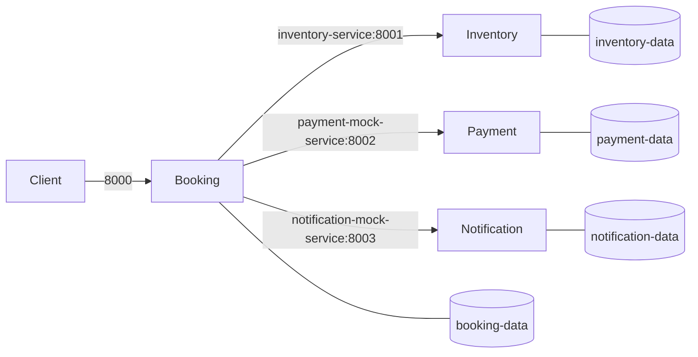

# Assignment 2 Deployment Report

**Containerization and Deployment of the Appointment Booking Microservices**
Scalable Services | MTech (WILP)

> Complete the evidence and team-specific fields after running the stack and recording your own demonstration. Do not claim a test, observation, contribution, or video that your team has not produced.

## 1. Application and deployment architecture

The Assignment 1 application has four FastAPI services: booking (port 8000), inventory (8001), payment mock (8002), and notification mock (8003). Docker Compose builds an image for each service, places them on its private network, and uses service names for HTTP communication. Each service owns a separate SQLite database stored in a named volume. Container health checks use each service's `/health` endpoint; Compose waits for inventory, payment, and notification to become healthy before starting booking.

## 2. Containerization and Compose deployment

Each service has its own Dockerfile. The images use Python 3.12 slim, install only that service's requirements, run Uvicorn on `0.0.0.0`, and run as a non-root account. Compose publishes ports 8000–8003 for local access, assigns a persistent named volume to each database, configures downstream URLs through environment variables, and defines health checks and startup dependencies.

From the repository root, run `docker compose up --build`. Check `docker compose ps` for health and `docker compose logs` for service output. Verify the main booking workflow through `http://localhost:8000/docs` or the documented curl request. Stop and restart with `docker compose down` and `docker compose up --build`; named volumes retain the databases. Attach your actual terminal/API evidence and note the date and environment here: **[team to complete]**.

## 3. Deployment troubleshooting challenge

### Problem and symptom

The included `docker-compose.challenge.yml` is a controlled fault reproduction: it overrides booking's inventory URL to use port 8099, while inventory listens on port 8001. Containers can start and the booking health check can pass, but a booking request cannot reach inventory. This is a configuration fault intentionally introduced for demonstration, not an unplanned production incident.

### Diagnosis

Run `docker compose -f docker-compose.yml -f docker-compose.challenge.yml up --build`, then inspect `docker compose ps` and `docker compose logs booking-service`. Submit the actual output from your run. Compare the resolved `INVENTORY_URL` with the inventory port in its Dockerfile and Compose service definition. **Evidence to insert:** [team to complete]

### Solution and validation

Remove the challenge override and use `INVENTORY_URL=http://inventory-service:8001`, the Compose service DNS name and container listening port. Restart with `docker compose up --build`, check health/logs, and complete a booking workflow with a fresh idempotency key. **Evidence to insert:** [team to complete]

### Learning reflection

Container-to-container requests use the Compose network and the destination container port. A host-published port is intended for access from outside the network. Health checks also help distinguish “process started” from “service ready”; they do not by themselves prove that the whole business workflow works. **Personal reflection in your own words:** [each student to complete]

## 4. Advanced deployment capability: Minikube / Kubernetes

Kubernetes manifests in `k8s/` define a Deployment and ClusterIP Service for each application service, health probes, and a separate PersistentVolumeClaim for each service database. Images are loaded into Minikube with local tags and `imagePullPolicy: Never`. The booking service uses Kubernetes service DNS names for its downstream URLs.

**Execution status:** Deployed and exercised locally on 2026-10-31. Minikube 1.39.0 with Kubernetes 1.37.0 ran using the Docker driver. All four Deployments rolled out with one ready pod each, and all four database PVCs reached `Bound`. The booking API was port-forwarded to `127.0.0.1:18000`; an end-to-end request returned `CONFIRMED` with `notification_status: RECORDED`. See [`../evidence/assignment2-minikube-run.txt`](../evidence/assignment2-minikube-run.txt) for the captured run summary. For a class presentation, rerun the commands and record your own terminal/demo evidence.

## 5. Contributions and AI-use declaration

**Team contributions:** [names and specific work to complete]
**AI-use declaration:** [follow course policy; describe actual assistance used and what the team reviewed or changed]

## Appendix: evidence checklist

- [ ] Image builds for all four services
- [ ] `docker compose ps` showing the services and health status
- [ ] Successful booking workflow and inter-service communication
- [ ] Useful container logs
- [ ] Stop/restart followed by a successful workflow
- [ ] Fault reproduction, diagnostic output, fix, and successful re-validation
- [ ] Demo video link (recommended 6–8 minutes)
