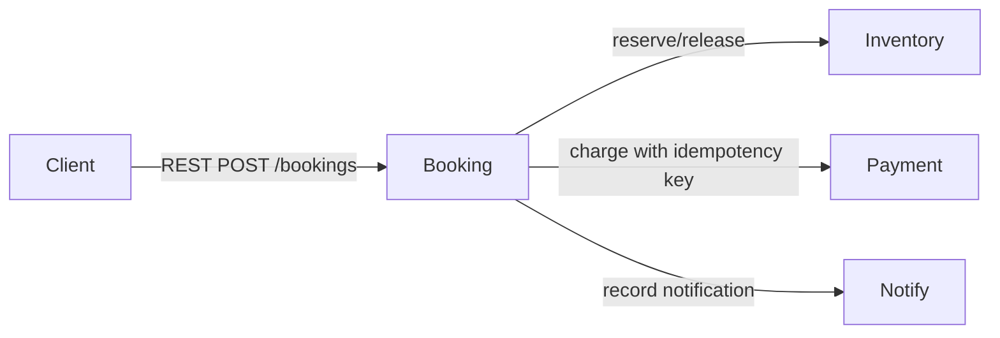

# Assignment 1 Design Report — Appointment Booking Microservices

> Complete this report using your own execution results, screenshots, team contributions and video link. Do not claim tests passed until you have run them.

## 1. Problem and scope
The application books a limited-capacity appointment slot. It demonstrates reservation contention, a non-repeatable booking operation, payment dependency failure, and compensation. Authentication, user interface and real payment integration are out of scope.

### Business rules
- BR1: Slot capacity must never become negative.
- BR2: A booking requires customer ID, slot ID, positive amount, and an idempotency key.
- BR3: A repeated key with the same payload returns the saved result; a different payload returns HTTP 409.
- BR4: If payment fails after reservation, the service attempts to release the reservation.
- BR5: A notification is attempted only after payment succeeds.

## 2. Service decomposition

| Service | Responsibility | Owns data | Port |
|---|---|---|---:|
| Booking | Orchestrates the transaction; stores booking and idempotency result | bookings, idempotency | 8000 |
| Inventory | Atomic capacity reservation and release | slots, reservations | 8001 |
| Payment mock | Simulates charge and deduplicates charges | payments | 8002 |
| Notification mock | Records simulated notification | notifications | 8003 |

The services communicate over REST/HTTP only. Each service has a separate SQLite database and never queries another service's tables.

## 3. Architecture and sequence

Happy path: Client → Booking → Inventory reserve → Payment charge → Notification record → Booking confirmed.

Failure path: Client → Booking → Inventory reserve → Payment fails after bounded retries → Booking requests Inventory release → Booking returns HTTP 503.

## 4. Data design

- Booking DB: `bookings(booking_id, customer_id, slot_id, amount, status, payment_id)` and `idempotency(idem_key, fingerprint, status_code, response_json)`.
- Inventory DB: `slots(slot_id, capacity, remaining)` and `reservations(reservation_id, slot_id, booking_id, status)`.
- Payment DB: `payments(payment_id, idempotency_key, fingerprint, booking_id, amount, status)`.
- Notification DB: `notifications(notification_id, booking_id, customer_id, message)`.

Cross-service relationships are IDs only; there are no cross-database foreign keys or joins.

## 5. API design

Each FastAPI service publishes an OpenAPI document at `/openapi.json` and interactive docs at `/docs`. Main endpoints and sample requests are listed in the root README. Capture examples and actual response bodies from your local run.

## 6. Engineering challenges

### Challenge 1 — concurrency
Inventory performs `UPDATE slots SET remaining=remaining-1 WHERE slot_id=? AND remaining>0` as one atomic database operation. The script sends 20 parallel requests for capacity-one `slot-2`. Attach actual output and final slot state. Explain why check-then-update can over-allocate.

### Challenge 2 — idempotency
Booking stores an idempotency key, canonical request fingerprint, HTTP status, and response. `BEGIN IMMEDIATE` serializes duplicate-key requests in this SQLite demo. Attach first call, exact replay, changed-payload conflict, and database evidence.

### Challenge 3A — resilience
Payment call has a timeout and three bounded attempts with exponential backoff plus jitter. If it remains unavailable, booking attempts a compensating release. Attach logs for the payment service being stopped and explain the crash-window limitation.

## 7. Testing
Run the BR1–BR5 unit tests with `python -m unittest discover -s tests -p test_business_rules.py -v`, plus `scripts/concurrency_test.py`, `scripts/idempotency_test.py`, and `scripts/e2e_test.py`. Include actual outputs and any failures; do not replace actual results with expected results. The `evidence/tests/` folder contains a recorded unit-test run and end-to-end run.

## 8. Design decisions and trade-offs
1. REST vs broker: REST is easier to inspect and satisfies the assignment; it creates runtime coupling.
2. Orchestration vs choreography: booking orchestration makes the transaction steps explicit; it centralizes workflow logic.
3. SQLite vs server database: SQLite lowers setup cost; a production deployment needs a database designed for concurrent multi-instance workloads.

## 9. Limitations and future work
Discuss the SQLite demo trade-offs, crash recovery/reconciliation, durable saga state, notification outbox, authentication, observability and deployment.

## 10. Demo video and team appendix
Insert your own 8–10 minute video link, contribution table, each student's reflection, and AI-use declaration.
